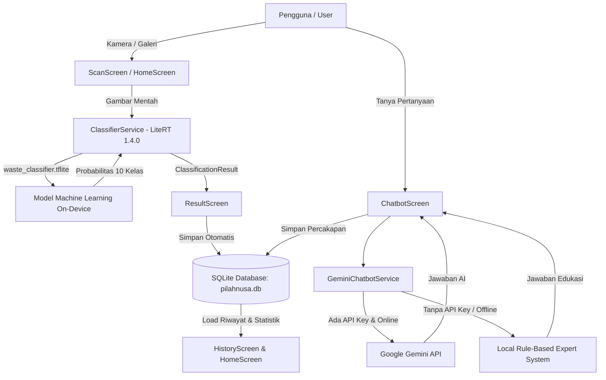
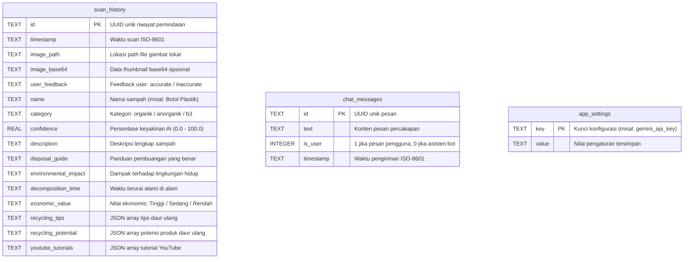
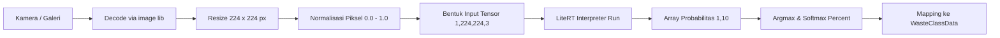

# Dokumentasi Arsitektur & Struktur Proyek PilahNusa AI Mobile

> **PilahNusa AI Mobile** adalah aplikasi mobile berbasis Flutter (Android/iOS/Desktop) untuk edukasi dan pengelolaan sampah berbasis kecerdasan buatan (*Artificial Intelligence*). Aplikasi ini mengintegrasikan model Machine Learning *on-device* berkecepatan tinggi via **Google AI Edge LiteRT**, penyimpanan lokal *offline-first* dengan **SQLite**, serta asisten edukasi cerdas lingkungan **Hybrid Chatbot (Online Gemini AI + Offline Expert System)**.

---

## 1. Ikhtisar & Arsitektur Sistem

PilahNusa AI dirancang dengan prinsip **Offline-First & On-Device Processing**. Seluruh proses pengenalan citra sampah dan penyimpanan riwayat dilakukan langsung pada perangkat (*edge computing*), sehingga aplikasi tetap dapat beroperasi tanpa ketergantungan koneksi internet.



---

## 2. Struktur Direktori Proyek

Berikut adalah hierarki lengkap direktori kode sumber (`lib/`), aset (`assets/`), dan konfigurasi:

```text
pilahnusa_mobile/
├── android/                             # Konfigurasi Native Android
│   ├── app/
│   │   ├── build.gradle.kts             # Gradle App: compileSdk 36, aaptOptions { noCompress("tflite") }
│   │   └── src/main/AndroidManifest.xml # Izin Kamera, Galeri, dan Internet
│   ├── gradle.properties                # Optimasi RAM JVM, org.gradle.daemon=false, vfs.watch=false
│   └── settings.gradle.kts              # Konfigurasi plugin Flutter & Android
├── assets/
│   ├── images/                          # Ilustrasi, ikon, & logo PilahNusa
│   └── models/
│       └── waste_classifier.tflite      # Model ML Quantized MobileNetV2 (34.8 MB)
├── lib/
│   ├── constants/                       # Nilai Konstan & Tema
│   │   └── app_colors.dart              # Palet warna primer, organik, anorganik, B3
│   ├── database/                        # Manajemen Basis Data Lokal
│   │   └── database_helper.dart         # Singleton SQLite (sqflite & sqflite_common_ffi)
│   ├── models/                          # Data Models & Entitas
│   │   ├── chat_message.dart            # Entitas pesan percakapan chatbot
│   │   ├── classification_result.dart   # Hasil klasifikasi inferensi AI
│   │   ├── history_item.dart            # Entitas riwayat pemindaian SQLite
│   │   └── waste_data.dart              # Single Source of Truth 10 kategori sampah & tutorial YouTube
│   ├── screens/                         # Tampilan Antarmuka (UI Pages)
│   │   ├── chatbot_screen.dart          # Layanan Tanya AI dengan integrasi API Key dialog
│   │   ├── guide_screen.dart            # Panduan pemilahan sampah interaktif & pencarian
│   │   ├── history_screen.dart          # Riwayat pemindaian sampah dengan filter kategori
│   │   ├── home_screen.dart             # Beranda: kartu statistik, CTA scan, & panduan 3 langkah
│   │   ├── main_navigation_screen.dart  # Bottom navigation bar (5 tab utama)
│   │   ├── result_screen.dart           # Detail hasil deteksi, tingkat akurasi, tips & video
│   │   └── scan_screen.dart             # Layar kamera & pemilih gambar galeri
│   ├── services/                        # Layanan Bisnis & Engine AI
│   │   ├── classifier_service.dart      # Engine TFLite LiteRT (Memory-Mapped file, tensor parsing)
│   │   └── gemini_chatbot_service.dart  # Hybrid Chatbot: Gemini 2.0/1.5 Flash + Offline Knowledge
│   ├── widgets/                         # Reusable UI Components
│   │   ├── category_badge.dart          # Badge kategori sampah (Organik, Anorganik, B3)
│   │   ├── confidence_bar.dart          # Indikator bar visual tingkat keyakinan AI
│   │   └── stat_card.dart               # Kartu statistik ringkasan beranda
│   └── main.dart                        # Titik masuk aplikasi (Theme, FFI Init, Preload AI)
├── test/
│   ├── database_test.dart               # Unit test database SQLite CRUD & models
│   └── widget_test.dart                 # Smoke test widget utama aplikasi
├── pubspec.yaml                         # Dependensi Flutter & deklarasi aset
└── README.md                            # Dokumentasi ringkas proyek
```

---

## 3. Arsitektur Database SQLite (`pilahnusa.db`)

Penyimpanan data lokal dikelola melalui `DatabaseHelper` dengan memanfaatkan `sqflite` untuk perangkat mobile (Android/iOS) dan `sqflite_common_ffi` untuk pengujian desktop/unit testing.

### Entity-Relationship Diagram (ERD)



### Penjelasan Skema Tabel

#### 1. Tabel `scan_history`
Menyimpan riwayat setiap pemindaian sampah yang dilakukan pengguna.
* **`id`** (`TEXT PRIMARY KEY`): Identifier unik string UUID v4.
* **`timestamp`** (`TEXT NOT NULL`): Waktu pemindaian dalam format ISO 8601 UTC.
* **`image_path`** (`TEXT`): Path absolut file foto yang disimpan di direktori aplikasi.
* **`name`** (`TEXT NOT NULL`): Label klasifikasi dari model (contoh: *Botol Plastik*, *Sisa Buah dan Sayur*).
* **`category`** (`TEXT NOT NULL`): Kategori utama (*organik*, *anorganik*, *b3*).
* **`confidence`** (`REAL NOT NULL`): Tingkat keyakinan model (contoh: *99.76*).
* **`recycling_tips` & `youtube_tutorials`** (`TEXT NOT NULL`): Struktur data serialisasi JSON berisi daftar panduan dan video YouTube resmi.

#### 2. Tabel `chat_messages`
Menyimpan seluruh percakapan antara pengguna dengan Asisten Edukasi PilahNusa AI.
* **`id`** (`TEXT PRIMARY KEY`): UUID unik tiap pesan.
* **`text`** (`TEXT NOT NULL`): Isi teks pertanyaan atau jawaban edukasi.
* **`is_user`** (`INTEGER NOT NULL`): Nilai boolean SQLite (`1` untuk pertanyaan user, `0` untuk balasan asisten).
* **`timestamp`** (`TEXT NOT NULL`): Waktu kirim pesan.

#### 3. Tabel `app_settings`
Menyimpan preferensi aplikasi dan konfigurasi fleksibel:
* **`key`** (`TEXT PRIMARY KEY`): Kunci pengaturan (contoh: `gemini_api_key`).
* **`value`** (`TEXT NOT NULL`): Nilai pengaturan tersimpan.

---

## 4. Mesin Machine Learning On-Device (TFLite & LiteRT)

### Spesifikasi Model (`waste_classifier.tflite`)
* **Arsitektur Dasar**: MobileNetV2 Transfer Learning
* **Ukuran File**: 34,787,200 bytes (~34.8 MB)
* **Format Bobot**: Float32 Tensor (`[1, 224, 224, 3]`)
* **Output Tensor**: Float32 Probabilitas 10 Kelas (`[1, 10]`)
* **Target Eksekusi**: Google AI Edge LiteRT 1.4.0 (`tflite_flutter 0.12.1`) dengan CPU XNNPACK Acceleration.

### 10 Kategori Sampah yang Didukung

| Index | Label Kelas | Kategori | Waktu Terurai | Nilai Ekonomi |
|:---:|:---|:---:|:---:|:---:|
| **0** | `Botol Plastik` | Anorganik | 450 Tahun | Tinggi |
| **1** | `Kaca` | Anorganik | 1 Juta Tahun | Sedang |
| **2** | `Kardus dan Kertas` | Anorganik | 2 - 5 Bulan | Tinggi |
| **3** | `Makanan Sisa` | Organik | 1 - 2 Minggu | Rendah |
| **4** | `Metal` | Anorganik | 50 - 500 Tahun | Sangat Tinggi |
| **5** | `Pakaian` | Anorganik | 20 - 200 Tahun | Sedang |
| **6** | `Plastik` | Anorganik | 100 - 500 Tahun | Sedang |
| **7** | `Sisa Buah dan Sayur` | Organik | 2 - 4 Minggu | Sedang |
| **8** | `Tumbuhan` | Organik | 1 - 3 Bulan | Rendah |
| **9** | `battery` | B3 | Tidak Terurai | Berbahaya |

### Pipeline Inferensi Gambar (`classifier_service.dart`)



1. **Pre-processing**: Gambar dibaca menggunakan library `image`, kemudian diubah ukurannya (*resize*) secara proporsional menjadi $224 \times 224$ piksel.
2. **Normalisasi**: Komponen warna merah ($R$), hijau ($G$), dan biru ($B$) masing-masing dibagi dengan $255.0$ sehingga rentang nilai berada pada interval $[0.0, 1.0]$.
3. **Pemuatan Berjenjang (*Multi-Strategy Loading*)**:
   - **Strategi 1 (`fromAsset`)**: Membaca langsung aset tanpa uncompress overhead (`noCompress 'tflite'`).
   - **Strategi 2 (`fromFile`)**: Menggunakan *Kernel Memory Mapping* (`mmap`) dari penyimpanan lokal (`appDir/waste_classifier.tflite`) untuk menjamin konsumsi RAM minimal.
   - **Strategi 3 (`fromBuffer`)**: Cadangan berbasis alokasi memori buffer langsung.

---

## 5. Layanan Chatbot Edukasi Lingkungan (`gemini_chatbot_service.dart`)

Layanan chatbot bekerja secara **Hybrid**:

### 1. Mode Online (Google Gemini API)
* Mengakses model **`gemini-2.0-flash`** / **`gemini-1.5-flash`** via REST API Google AI Studio.
* Menerapkan *System Prompt* ketat untuk membatasi jawaban hanya seputar lingkungan hidup, pemilahan sampah, panduan daur ulang, dan penggunaan aplikasi PilahNusa AI.
* Output teks dibersihkan dari format markdown berlebih agar nyaman dibaca pada layar perangkat bergerak.

### 2. Mode Offline (Rule-Based Expert Knowledge Engine)
Jika perangkat tidak memiliki koneksi internet atau pengguna belum memasukkan API Key:
* Sistem otomatis beralih ke mesin pakar lokal berbasis basis aturan cerdas.
* Menjawab secara komprehensif pertanyaan lingkungan penting:
  * **Larangan Membuang Sampah di Selokan/Sungai**: Edukasi bahaya banjir, sarang nyamuk DBD/leptospirosis, pencemaran air, dan mikroplastik.
  * **Bahaya Membakar Sampah**: Penjelasan gas karsinogenik dioksin/furan dan penyakit ISPA.
  * **Pengelolaan Minyak Jelantah**: Peringatan larangan membuang ke wastafel dan solusi daur ulang biodiesel.
  * **Styrofoam, Popok Bayi, dan Limbah Medis**: Panduan pembuangan higienis dan pemisahan limbah B3.
  * **Prinsip 3R & Panduan Bank Sampah**: Edukasi Reduce-Reuse-Recycle serta nilai ekonomis sampah.

---

## 6. Antarmuka Pengguna & Navigasi

Aplikasi menggunakan Material 3 dengan tata letak 5 menu utama pada `MainNavigationScreen`:

1. **Beranda (`HomeScreen`)**:
   - Kartu ringkasan total scan sampah serta penghitung per kategori (*Organik*, *Anorganik*, *B3*).
   - Tombol akses cepat *Scan Sekarang* dan *Unggah Galeri*.
   - Panduan 3 langkah mudah memilah sampah dan kartu scan terbaru.
2. **Scan (`ScanScreen`)**:
   - Area bidik kamera dan integrasi `image_picker`.
   - Indikator pemrosesan cerdas saat AI melakukan inferensi gambar.
3. **Hasil (`ResultScreen`)**:
   - Tampilan foto objek sampah yang baru saja dipindai.
   - Badge kategori, persentase keyakinan model, waktu dekomposisi di alam, dan nilai ekonomi.
   - Kartu tips daur ulang dan tautan langsung ke video tutorial YouTube resmi.
   - Tombol bagikan (*Share Plus*) dan tombol umpan balik pengguna (*Akurat / Tidak Akurat*).
4. **Riwayat (`HistoryScreen`)**:
   - Daftar seluruh riwayat yang tersimpan di SQLite secara kronologis (*terbaru di atas*).
   - Fitur filter tab: *Semua*, *Organik*, *Anorganik*, dan *B3*.
   - Opsi penghapusan item individual atau pembersihan seluruh riwayat.
5. **Panduan (`GuideScreen`)**:
   - Ensiklopedia pemilahan sampah 10 kelas.
   - Fitur pencarian instan dan kartu akordeon per jenis sampah.
6. **Tanya AI (`ChatbotScreen`)**:
   - Antarmuka chat interaktif dengan gelembung percakapan modern.
   - Chip saran pertanyaan cepat (*Suggested Prompts*).
   - Dialog konfigurasi kunci API Google Gemini (ikon kunci 🔑).

---

## 7. Pengujian & Penjaminan Kualitas (Quality Assurance)

Proyek ini dilengkapi dengan unit test otomatis pada direktori `test/`:
* **`database_test.dart`**:
  - Memverifikasi keutuhan 10 kelas sampah pada `WASTE_DATA_MAP`.
  - Memverifikasi pembuatan instance `ClassificationResult`.
  - Menguji operasi CRUD SQLite *in-memory* (Insert, Query, Update Feedback, Delete, Clear, Statistik).
* **`widget_test.dart`**:
  - Smoke test inisialisasi aplikasi `PilahNusaApp` dan rendering navigasi.

### Menjalankan Pengujian
```bash
flutter test test/database_test.dart test/widget_test.dart
```

---

## 8. Panduan Kompilasi & Build APK

### Kompilasi Release APK untuk Smartphone (Android ARM64)
Untuk menghasilkan file APK rilis yang dioptimalkan untuk perangkat modern Android 64-bit:

```bash
flutter build apk --target-platform android-arm64 --no-tree-shake-icons
```
Output biner akan berada pada direktori:
`build/app/outputs/flutter-apk/app-release.apk`

---
*Dokumentasi ini disusun secara komprehensif untuk proyek PilahNusa AI Mobile.*
